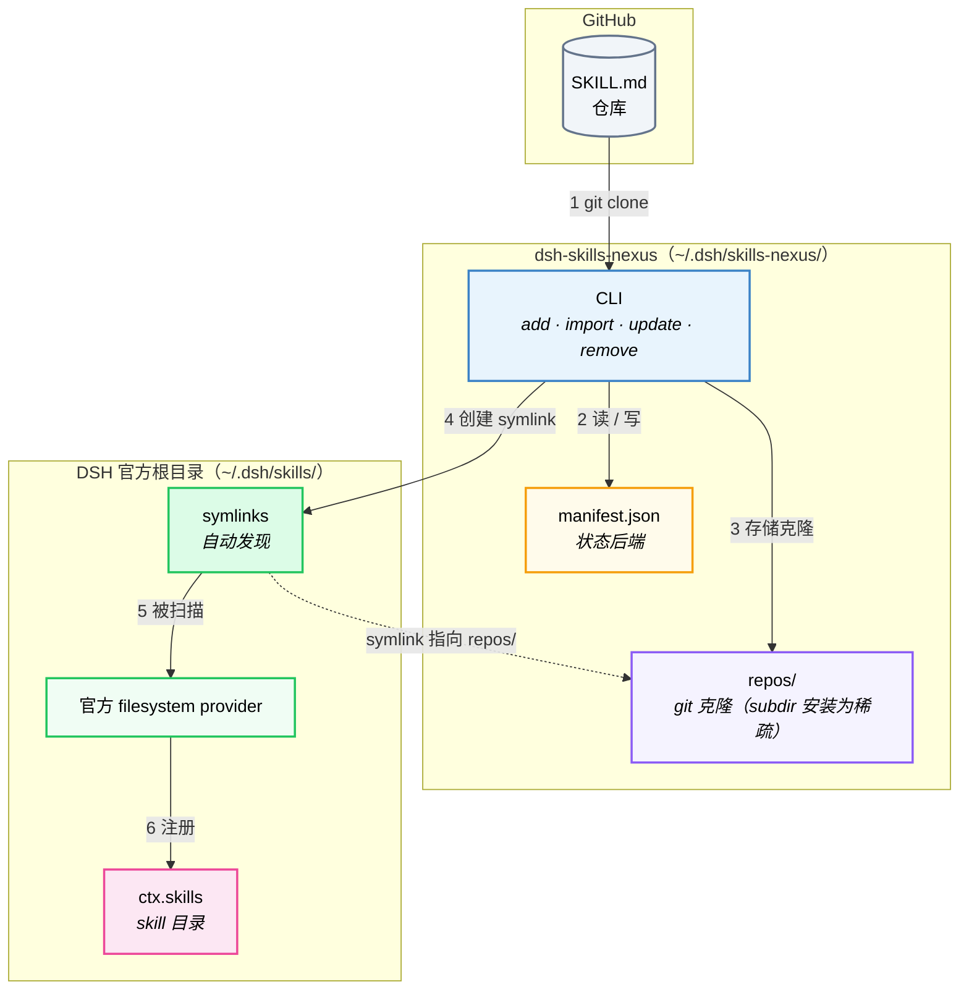

# 架构

[English](ARCHITECTURE.md) | **中文**

dsh-skills-nexus 的内部工作原理：数据流、目录布局、SKILL.md 发现规则和关键设计决策。

## 概览



- **CLI 管写入**：`add` / `import` / `update` / `remove` 等命令操作 git、写 `manifest.json`，并在 `~/.dsh/skills/` 中创建/删除 symlink
- **外部引用**：`link trae-cn` / `link trae` / `link qoder` / `link qoder-cn` 创建外部条目，符号链接到用户已有的目录——nexus 不克隆、不删除那些目录
- **官方 provider 管读取**：DSH 内置的 filesystem provider 自动扫描 `~/.dsh/skills/`，发现 symlink 指向的 skill
- **两边解耦**：CLI 只管克隆和 symlink；发现和加载完全交给官方 provider

## 工作原理

```
dsh-skills-nexus add github:owner/repo
   └─ git clone --depth 1 →  ~/.dsh/skills-nexus/repos/<name>/
                              （带 --subdir 时：partial clone + cone sparse-checkout，
                               无关目录不检出）
   └─ 归一化 frontmatter     （修正不合法名称为 kebab-case，补全缺失的 description）
   └─ 创建 symlink        →  ~/.dsh/skills/<skill-name>/  →  指向 repos/<name>/
   └─ 追加条目              →  ~/.dsh/skills-nexus/manifest.json

dsh-skills-nexus import package.zip --locked
   └─ 校验 labelled source metadata 与完整 commit SHA
   └─ 浅克隆/获取记录的 commit，再 detached checkout
   └─ 以 locked: true 写入条目；仅当远端明确报告该 commit 不可获取时
      才使用包内载荷

dsh-skills-nexus link <source>  # trae-cn 或 trae
   └─ 从 SOURCE_CONFIGS 解析根目录（覆盖参数 > 环境变量 > 默认候选）
   └─ 扫描 <root>/skills/ 的一层技能目录
   └─ 对每个发现的技能：
      └─ 创建 ownership: 'external' 的 manifest 条目
      └─ 创建 symlink → ~/.dsh/skills/<name>/ → 指向外部目录
   └─ 条目携带 groupPath 用于层级分组

DSH filesystem provider（官方内置）
   └─ 扫描 ~/.dsh/skills/ → 自动发现所有 symlink 指向的 skill
   └─ 读取每个 SKILL.md 的 frontmatter + body
```

关键设计点：

- **用 symlink 替代自定义 provider**：官方 filesystem provider 负责发现、文件监听和错误容错——不用维护自定义 provider 代码。
- **每个 skill 独立的 `resourceBase`**：每个 symlink 指向该 skill 自己的克隆目录，因此相对路径（`references/`、`scripts/`、`assets/`）能正确解析。
- **多 skill 仓库支持**：集合仓库为每个发现的 skill 创建一个 symlink——都展平在 `~/.dsh/skills/` 顶层，官方 provider 单层扫描即可发现。
- **安装时归一化**：修正不合法的 frontmatter 名称，补全缺失的 description，确保官方 provider 不会静默跳过 skill。
- **enable/disable 轻量**：只是创建/删除 symlink，克隆数据始终保留在 `repos/` 中。
- **外部条目（`link` 通道）**：`ownership: 'external'` 的条目指向用户拥有的目录。`entrySkillDir(entry)` 对这些条目返回外部目录（对管理条目返回克隆目录）。`remove` 只删除链接和 manifest 条目，不删除目标目录。外部条目携带 `groupPath` 用于层级分组；`enable`/`disable --group <path>` 按前缀批量切换条目。
- **显式 package lock 是 manifest 事实**：`import --locked` 检出包记录的精确 commit 后写入 `locked: true`。健康检查不会根据 detached HEAD 推导该字段，因此普通 tag/commit pin 仍可区分；成功执行 `switch-version` 后显式锁被清除。

## SKILL.md 发现规则（每个克隆仓库内）

1. `<repoRoot>/SKILL.md` — 优先级最高；整个仓库作为单个 skill。
2. `<repoRoot>/<name>/SKILL.md` — 仓库按子目录打包多个 skill（仅单层，与官方 filesystem provider 一致；嵌套的 `**/SKILL.md` 被排除）。
3. `<repoRoot>/<name>.md` — 扁平 Markdown 文件（无配套资源）。

扁平扫描会跳过 `README.md` / `CHANGELOG.md` / `LICENSE.md`。

### 支持的 frontmatter 字段

必填：`name`、`description`。可选且被 provider 识别：
`disable-model-invocation`（布尔）、`user-invocable`（布尔）。其余字段
（`whenToUse`、`metadata` 等）会被解析并保留，但 nexus 不做进一步解释。

> **注意**：nexus 在安装时会归一化不合法的 frontmatter 名称（修正为 kebab-case），并补全缺失的 description，确保官方 provider 不会因为 frontmatter 有问题而静默跳过 skill。

## 文件系统布局

```
~/.dsh/
├── skills/                          # DSH 官方 skills 根目录（官方 provider 扫描这里）
│   ├── skill-a/        → symlink →  ~/.dsh/skills-nexus/repos/repo-a/
│   ├── skill-b/        → symlink →  ~/.dsh/skills-nexus/repos/repo-b/skills/foo/
│   └── trae-cn.skills.brainstorming/ → symlink →  ~/.trae-cn/skills/brainstorming/  （外部条目）
│
└── skills-nexus/
    ├── manifest.json                 # 状态后端：CLI 写
    └── repos/                        # git 克隆存放处（subdir 安装为稀疏）
        ├── repo-a/                  # 完整 git 克隆（nexus 管理）
        │   ├── SKILL.md
        │   └── references/…
        └── repo-b/                  # 稀疏克隆：只检出 skills/foo
            └── skills/
                └── foo/
                    └── SKILL.md
```

**为什么有两层目录？**

- `repos/` 是 nexus 的私有存储——所有 git 克隆都放在这里，保持原始结构不变。CLI 通过 git 对这些目录做 clone / pull / checkout 等操作。克隆由 nexus 管理：`add` / `update` 可能原地归一化 frontmatter（修正非法名称、补全缺失的 `description`），`update` 在拉取前会丢弃本地改动（有警告）——请勿手动编辑克隆。
- `~/.dsh/skills/` 是 DSH 官方的 skills 根目录——官方 filesystem provider 只扫描这一层。nexus 在这里为每个 skill 创建一个 symlink，指向 `repos/` 中的实际目录。这样官方 provider 就能自动发现所有 skill，无需自定义 provider。
- **外部条目**（由 `link trae-cn` / `link trae` / `link qoder` / `link qoder-cn` 创建）符号链接到 nexus 控制范围之外的目录——通常是 `~/.trae-cn/skills/`、`~/.trae/skills/`，或 `~/.qoder/` 与 `~/.qoder-cn/` 下的某个技能（用户级 `skills/`，或市场插件声明的技能目录）。nexus 不克隆、不更新、不删除那些目录。`remove` 只删除链接和 manifest 条目。

`src/external.ts` 的来源注册表配置 `envVar`、`defaultDirName` 或有序 `rootCandidates`，以及每个来源自带的 `discover`（`(root) => DiscoveredSkill[]`）。
`trae-cn` 使用 `TRAE_CN_DIR` / `.trae-cn`，`trae` 使用 `TRAE_DIR` / `.trae`，两者都走 `plainDiscovery(['skills'])`。
`qoder` 使用 `QODER_DIR` / `.qoder`，`qoder-cn` 使用 `QODER_CN_DIR` / `.qoder-cn`；两者共用 `src/qoder.ts` 的同一个发现函数，因为两个客户端的布局一致：用户级 `<root>/skills/` + `<root>/plugins/installed_plugins_v2.json` 中列出的市场插件，逐个读插件的 `plugin.json`。
`qoder-bundler` 在两个根里都一律排除——那些插件随客户端下发，依赖 Qoder 宿主运行时。
`--source-dir` 覆盖当前来源根目录，旧 `--trae-cn-dir` 是较低优先级的兼容别名。
`resolveSourceRoots` 按顺序检查全部默认候选，显式参数或环境变量覆盖时只检查该路径。
`discoverSkills` 按绝对目录去重，`planLinkLocal` 对跨根同名管理条目保留第一项，并用发现结果里的 `segment`（固定子目录名或插件名）拼出扁平名：`['trae-cn', 'skills', 'brainstorming']` 与 `['qoder', 'superpowers', 'brainstorming']`。
每个声明目录仍只扫一层，不支持嵌套布局，也从不包含内置技能。
卸载默认组用 `remove --group trae`、`remove --group trae-cn`、`remove --group qoder` 或 `remove --group qoder-cn`，外部目录保持不动。

`enable` / `disable` 就是创建/删除 symlink——轻量且原子化，克隆数据始终保留在 `repos/` 中。`remove` 则同时删除 symlink 和克隆目录。

可用 `DSH_HOME`（默认 `~/.dsh`）或 `DSH_SKILLS_NEXUS_HOME`（默认 `<DSH_HOME>/skills-nexus`）覆盖根目录。
